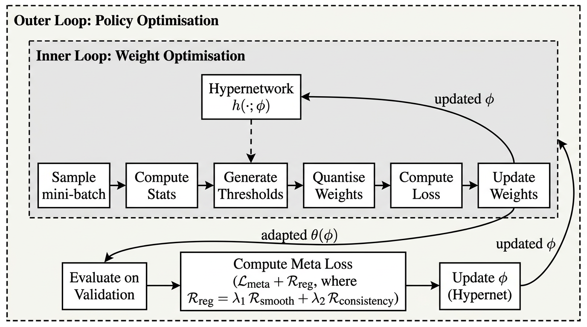
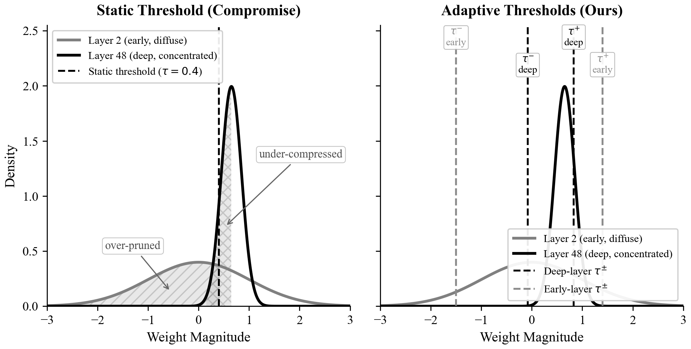
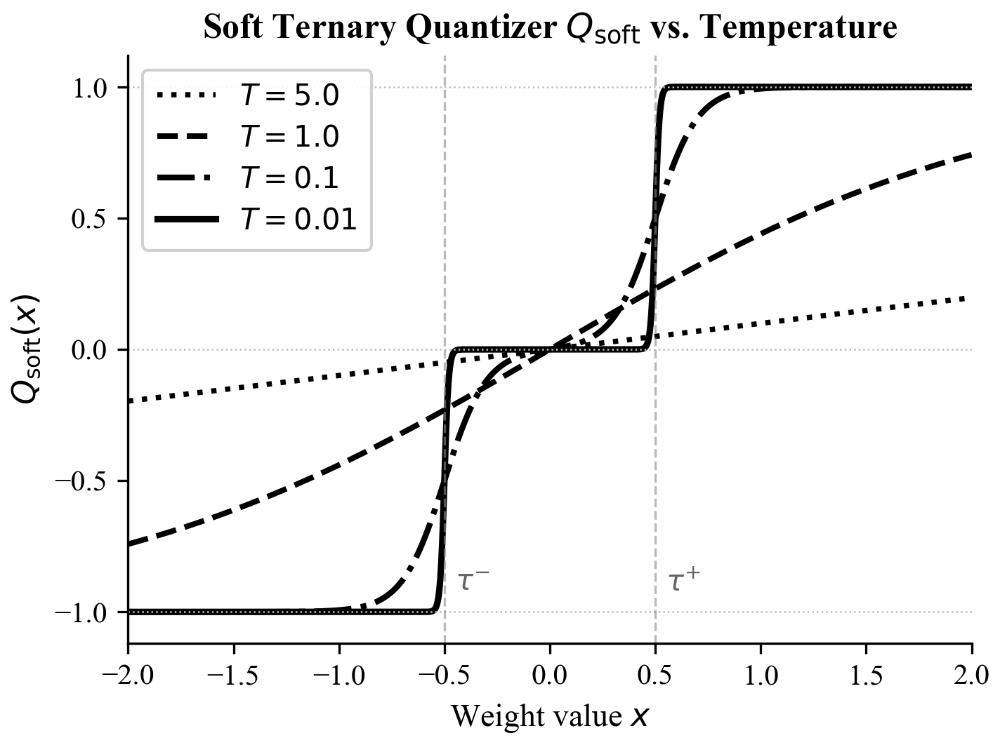

# Learning Layer-Specific Ternary Thresholds via Hypernetwork Meta-Optimization

Official code for the WACV 2027 paper. A compact hypernetwork, shared across
all layers, reads each layer's activation and gradient statistics and outputs
that layer's asymmetric ternary thresholds. It is trained by first-order
bilevel optimization through a temperature-annealed soft quantizer. Every
number in the paper comes from a run directory produced by this code and
summarized by `scripts/aggregate.py`.

<p align="center">
  
</p>

## Method

**Why per-layer thresholds.** Layers differ in how their weights are
distributed, so one threshold can zero out too much of one layer and too
little of another. The hypernetwork sets each layer's thresholds from that
layer's own statistics.

<p align="center">
  
  <br><em>Schematic with two idealized weight distributions.</em>
</p>

- **Ternary layers** (`src/models/layers.py`): every Conv2d/Linear except the
  stem and the classifier computes `W_q = α_l · Q(W / σ(W); τ+, τ−)`, with a
  per-layer least-squares scale `α_l` (the TWN scale for hard ternary
  weights). Thresholds are in units of the layer's weight std, with
  `0 < τ+ < 1` and `−1 < τ− < 0`.
- **Statistics** `[μ, σ, γ, ρ]` (`src/quantization/statistics.py`):
  input-activation mean/std/sparsity and weight-gradient magnitude,
  EMA-smoothed, fed as `[μ, log σ, log γ, ρ]` standardized across layers.
- **Hypernetwork** (`src/quantization/hypernetwork.py`): shared
  4→64→64→2 MLP (4,610 parameters), sigmoid-parameterized thresholds.
- **Bilevel training** (`src/training/loop.py`): θ is trained on the train
  split; every K = 5 inner steps, φ takes one step on a held-out batch (10% of
  the CIFAR train set, or 10 images per class for ImageNet), using a
  first-order meta-gradient.
- **Soft quantizer** (`src/quantization/quantizers.py`): Eq. 9 of the paper,
  with an annealed temperature. With `--train_mode hard_soft` the forward
  pass uses exact ternary weights and Q_soft only supplies the gradients.
  **Every reported accuracy uses exact hard ternary weights.**

<p align="center">
  
</p>

**Baselines** (`--method`): `fp`, `twn`, `ttq`, `lsq` (three levels),
`rtn`, `fatnn`, `metaquant`, `fixed` (one global ±τ, same quantizer as ours,
τ tuned on held-out data), `perlayer` (free per-layer τ), and `ours_joint`
(single-level ablation). Every baseline runs under the same protocol as ours
(initialisation, data, epochs, optimizer, schedule) with ternary weights and
full-precision activations. RTN, FATNN and MetaQuant use their published
weight quantizers; the adaptations needed for this setting (MetaQuant with a
ternary TWN forward instead of binary, FATNN's weight normalisation per layer,
RTN's initialisation) are documented in `src/quantization/quantizers.py` and
`src/quantization/metaquant.py`.
**Backbones** (`--model`): `resnet18 resnet50 mobilenetv2 convnext_t vit_s16
swin_t` (timm ImageNet-1k weights; `vit_s16` uses DeiT-S weights).

## Setup
Python ≥ 3.10.
```bash
# After extracting the source archive, enter its directory.
cd <source-directory>
python -m venv ~/envs/ternary && source ~/envs/ternary/bin/activate
pip install -r requirements.txt   # Alliance: pip install --no-index torch torchvision numpy timm
python scripts/prefetch.py        # CIFAR-10/100 + all weights, then an offline check
make test                         # CPU smoke tests, about 1-2 min: ALL PASSED
```
The exact package versions used by each run are recorded in
`runs/<name>/env.txt`. Run outputs, downloaded data, and checkpoints are not
included in the source archive; they are created locally when you run the code.

## Running one experiment
```bash
# full-precision fine-tune (also the init for every ternary run)
python run.py --dataset cifar10 --model resnet18 --method fp --seed 0
# a ternary method, initialised from runs/cifar10_resnet18_fp_s0
python run.py --dataset cifar10 --model resnet18 --method ours --seed 0
# the paper settings from a config file, with any CLI override
python run.py --config configs/cifar.json --dataset cifar10 \
    --model vit_s16 --method ours --seed 1
python run.py --help              # every argument, with defaults
```
No experiment needs a code edit: every setting is a command-line argument or a
`--config` JSON key (the command line wins). `--deterministic` gives identical
reruns at some cost in speed.

Each run writes `runs/<dataset>_<model>_<method><tag>_s<seed>/`:

| file | content |
|---|---|
| `cmd.txt` | exact launch command |
| `config.json` | fully resolved configuration |
| `env.txt` | Python/torch/CUDA/timm versions, GPU, git commit, SLURM ids |
| `logs/metrics.jsonl` | one JSON line per epoch (loss, held-out accuracy, T, thresholds) |
| `checkpoints/last.pt` | resumable state; rerunning the same command resumes |
| `checkpoints/best.pt` | weights with the best held-out accuracy |
| `results.json` | final test accuracy, thresholds, per-layer profile, timing |

## Running sweeps
```bash
python scripts/make_jobs.py main --data_dir '$DATA' --config configs/cifar.json
# SLURM (e.g. Alliance clusters): one array per wave, chained; logs in slurm_logs/
NOTIFY_EMAIL=you@uni.ca bash scripts/slurm_submit.sh jobs/main.txt def-yourprof
# machines without SLURM: one job per GPU, logs in queue_logs/
python scripts/gpu_queue.py jobs/main.txt --gpus 0,1
```
Resubmitting a jobs file skips finished runs and resumes unfinished ones.

## Reproducing the paper
| paper item | command (after the FP wave) |
|---|---|
| Training-quantizer selection (held-out) | `make_jobs.py select` |
| CIFAR-10/100 tables (6 backbones, 3 seeds) | `make_jobs.py main --config configs/cifar.json` |
| ImageNet table | `make_jobs.py imagenet --config configs/imagenet.json` |
| Ablation and sensitivity table | `make_jobs.py ablation --config configs/cifar.json` |
| All tables as LaTeX | `python scripts/aggregate.py --latex tables` |

Every setting (training quantizer, the fixed baseline's τ) is chosen on
held-out accuracy (`aggregate.py --heldout`), never on test accuracy.

## Development
```bash
pip install -r requirements-dev.txt && pre-commit install
make format   # isort + black (79 columns)
make lint     # isort/black check + flake8
make test     # CPU smoke tests
```

## Repository layout
```
run.py                     single entry point (argparse + --config)
configs/                   paper settings (JSON)
src/models/                backbones, ternary layers
src/quantization/          quantizers, hypernetwork, statistics
src/training/              training loops, methods
src/utils/data.py          CIFAR / ImageNet loaders, held-out split
scripts/                   job generation, SLURM, queue, aggregation, prefetch
tests/smoke_test.py        CPU checks (make test)
docs/                      figures
```

```
